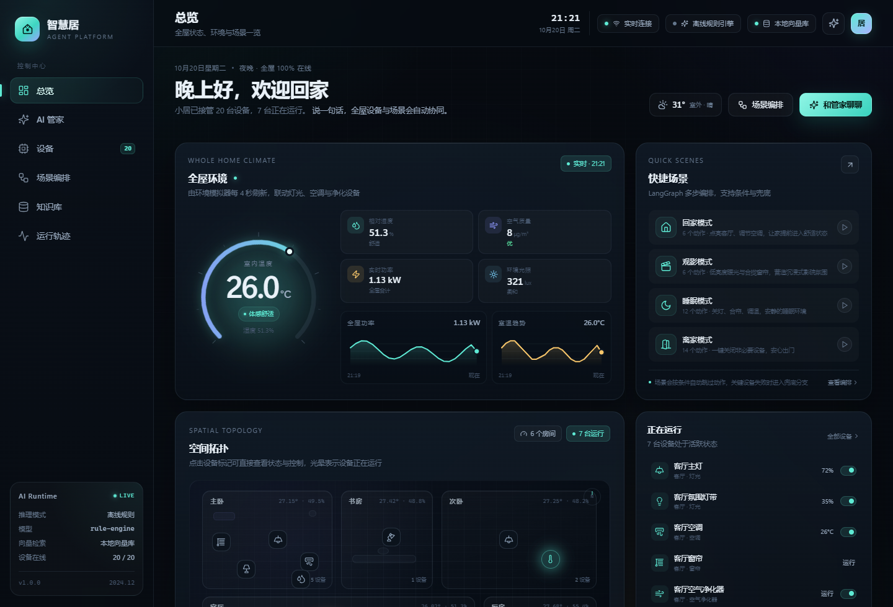
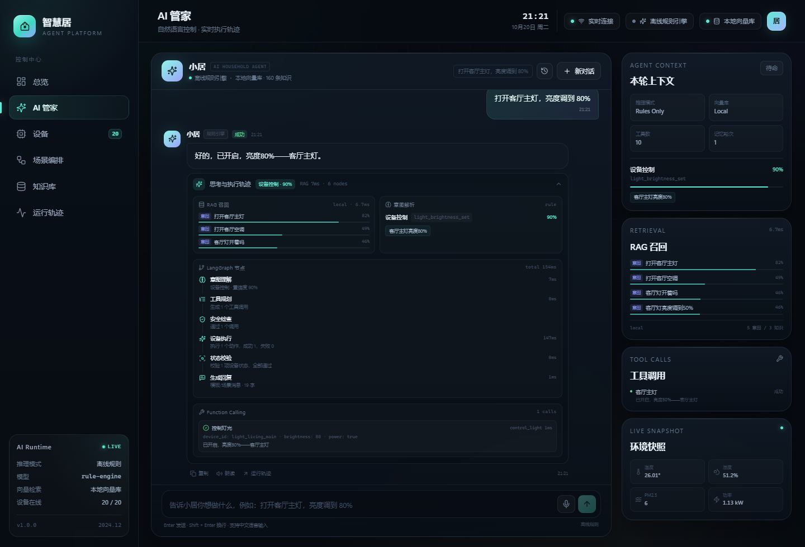
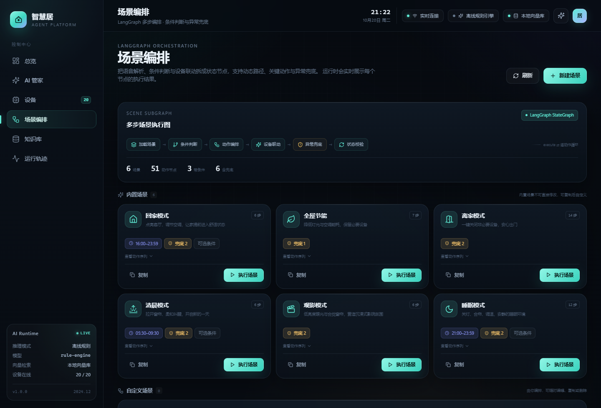
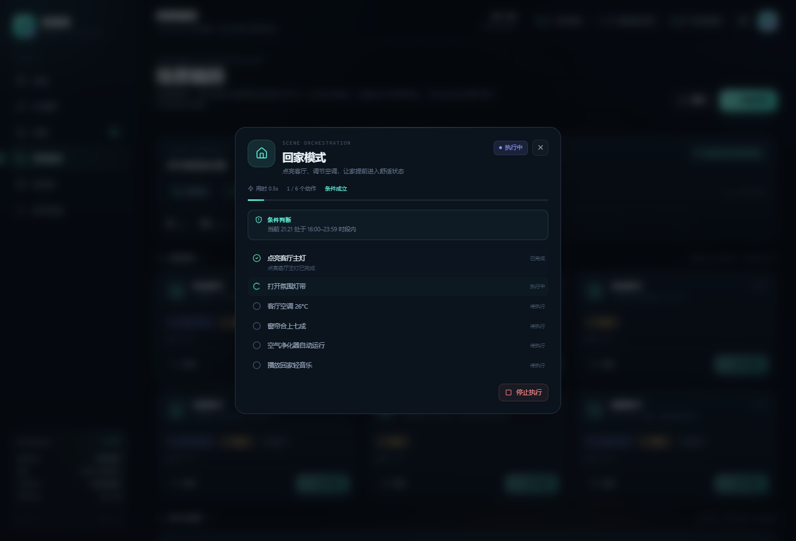
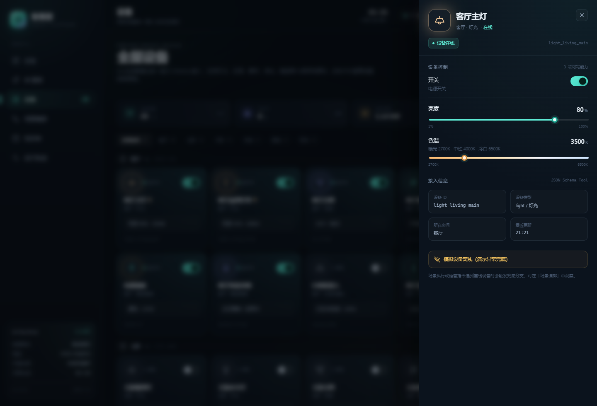
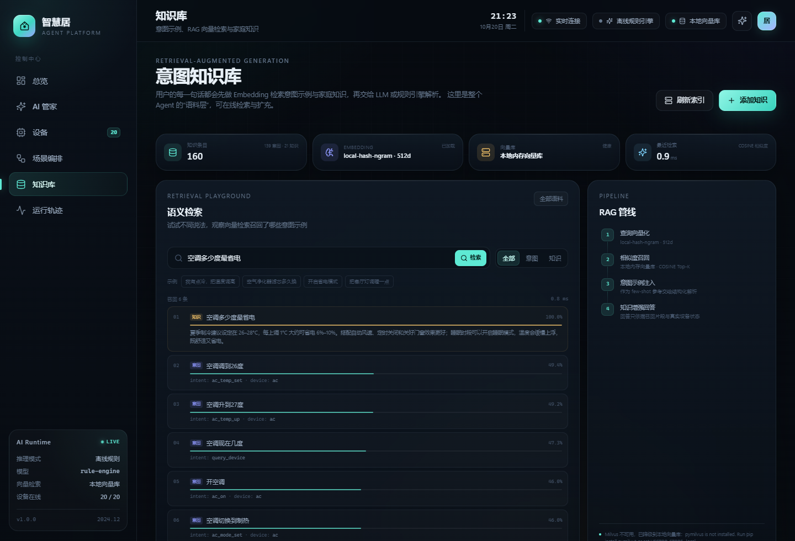
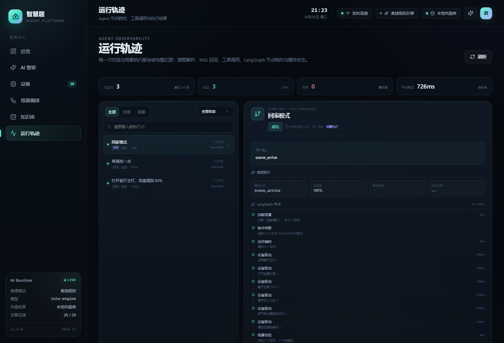
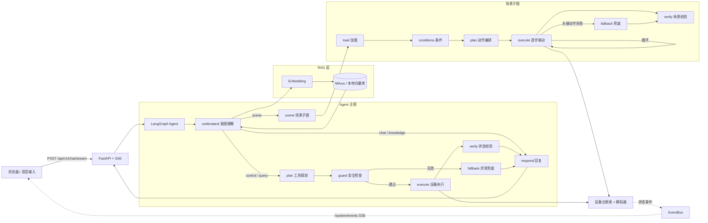

# 智慧居 · 智能家居 AI Agent 平台

> FastAPI + SSE + RAG（Milvus）+ LangGraph + Function Calling

一个可以用自然语言控制全屋设备的智能家居 Agent：用户说一句「打开客厅主灯，亮度调到 80%」或「开启回家模式」，系统会完成 **向量检索 → 意图识别 → 工具调用 → 设备执行 → 状态校验 → 自然语言回复** 的完整闭环，并通过 SSE 把每一步实时展示出来。

没有大模型 API Key、没有 Milvus、没有真实硬件也能完整演示：项目内置离线规则引擎、本地向量库、设备模拟器与可视化控制台。

> 配置 API Key、Docker 部署、运行模式说明与「回家/离家」场景演示，详见 [使用手册](docs/user-manual.md)。

---

## 目录

- [功能概览](#功能概览)
- [界面预览](#界面预览)
- [技术架构](#技术架构)
- [核心实现](#核心实现)
- [快速开始](#快速开始)
- [使用手册](docs/user-manual.md)
- [演示脚本](#演示脚本)
- [API 一览](#api-一览)
- [项目结构](#项目结构)
- [测试](#测试)
- [设计边界与后续规划](#设计边界与后续规划)

---

## 功能概览

| 能力 | 说明 |
| --- | --- |
| 自然语言设备控制 | 灯光、空调、窗帘、净化器、加湿器、插座、音箱、扫地机器人、传感器，共 9 类设备 |
| 多步指令 | 「关闭客厅灯，然后打开主卧空调」一次解析为多个工具调用 |
| 多轮上下文 | 「再亮一点」「关空调」→「客厅」可结合上一轮目标与澄清结果 |
| 歧义澄清 | 两台空调时先问「你想控制哪一台」，用户回答后继续执行 |
| RAG 意图识别 | Embedding + 向量检索召回意图示例与家庭知识，兼容 Milvus 与本地降级 |
| Function Calling | 设备能力自动映射为 10 个 JSON Schema 工具，参数范围校验与裁剪 |
| LangGraph 场景编排 | 条件判断、动作循环、关键动作失败兜底、执行后状态校验 |
| SSE 实时轨迹 | 节点开始/结束、RAG 召回、意图、工具调用、场景步骤、回复 token 全部实时推送 |
| 家庭知识问答 | 省电建议、滤芯保养、场景推荐等，回答基于检索片段 |
| 设备模拟器 | 空调影响室温、灯光影响光照、净化器降低 PM2.5，状态每 4 秒推送前端 |
| 可观测性 | 每次对话/场景的节点耗时、工具调用、结果与 trace 落库，可在「运行轨迹」回看 |
| 一键演示 | 无 Key 离线模式、内置 160 条语料、6 个内置场景、20 台模拟设备 |

---

## 界面预览

**总览：全屋环境、空间拓扑与快捷场景**



**AI 管家：流式回复 + 意图/工具/节点实时轨迹**



**场景编排：LangGraph 子图与内置/自定义场景**



**场景执行：条件、逐步联动与兜底结果**



**设备控制抽屉：异构设备能力统一渲染**



**RAG 知识库：语义检索与语料管理**



**运行轨迹：Agent 节点耗时与工具调用回放**



---

## 技术架构



### 一次请求的事件流

```text
run_start → node_start(understand) → retrieval → intent → node_end
          → node_start(plan) → plan → node_end
          → node_start(guard) → guard → node_end
          → node_start(execute) → tool_call → tool_result → node_end
          → node_start(verify) → verification → node_end
          → node_start(respond) → token... → response → done
```

前端按事件增量更新消息气泡、意图卡片、工具列表、节点时间线与场景执行浮层，不需要轮询。

> 更完整的节点状态、事件协议、数据表与设计取舍见 [docs/architecture.md](docs/architecture.md)。

---

## 核心实现

### 1. RAG 意图识别（`backend/app/rag`）

- **语料**：内置 139 条意图示例 + 21 条家庭知识，覆盖控制、查询、场景、闲聊、澄清与知识问答。
- **Embedding**：
  - 默认 `local`：零依赖的字符 n-gram + 特征哈希（512 维），中文短句检索效果足够演示；
  - 可选 `openai`：任意 OpenAI 兼容 embeddings 接口（通义、DeepSeek、SiliconFlow 等）。
- **向量库**：
  - `VECTOR_STORE=auto`：优先连接 Milvus，连接失败自动降级本地内存向量库；
  - `VECTOR_STORE=milvus`：连接真实 Milvus（`docker-compose.milvus.yml` 可一键启动）；
  - COSINE 相似度，检索结果回填到 LLM Prompt 作为 few-shot 示例。
- **混合决策**：LLM 可用时由 LLM 输出结构化 JSON；输出不合法、服务不可用或未配置 Key 时，自动切换到规则解析，保证演示永不中断。

### 2. Function Calling（`backend/app/agent/tools.py`）

设备能力在 `devices/specs.py` 中只声明一次，工具 Schema 从中生成：

| 工具 | 能力 |
| --- | --- |
| `control_light` | 开关、亮度 1–100、色温 2700–6500K |
| `control_ac` | 开关、16–30°C、制冷/制热/除湿/送风/自动、风速 |
| `control_curtain` | 开合度 0–100% |
| `control_purifier` | 开关、自动/睡眠/强力 |
| `control_humidifier` | 开关、目标湿度 30–80% |
| `control_socket` | 通断电 |
| `control_speaker` | 开关、音量、播放状态、内容 |
| `control_vacuum` | 启动/停止、清扫模式 |
| `query_device` | 单设备 / 房间 / 类型 / 全屋状态 |
| `query_environment` | 温湿度、PM2.5、CO₂、光照、功率 |

`guard` 节点执行二次校验：设备是否存在、是否在线、是否支持该能力、参数是否越界。越界参数会被裁剪并提示，未知能力直接拦截，避免把错误指令下发给设备。

### 3. LangGraph 编排（`backend/app/agent/graph.py`、`scene_graph.py`）

**主图**：`understand → plan → guard → execute → verify → respond`，另有 `scene` 与 `fallback` 分支。

**场景子图**：`load → conditions → plan → execute（逐动作循环）→ fallback（关键动作失败）→ verify`。

- 条件支持时间窗、温度/湿度阈值、设备属性；
- 动作支持顺序、延时、关键动作标记与可选条件；
- 关键动作失败会进入兜底分支，尽最大可能恢复家庭状态；
- 场景执行完成后再做一次设备状态校验，结果写回运行记录。

### 4. 设备抽象与模拟（`backend/app/devices`、`core/simulator.py`）

- 每类设备声明可写能力、取值范围与读数字段，前端控制面板、工具 Schema、场景编辑器三处共用同一份定义；
- 模拟器让空调拉低室温、灯光抬高光照、净化器降低 PM2.5、扫地机消耗电量，并计算全屋功率；
- 设备状态变更通过 `EventBus` 推送 `/api/v1/system/events`，前端实时刷新；
- 可手动把设备设为离线，用来演示场景兜底与错误提示。

### 5. SSE 与可观测性

- `POST /api/v1/chat/stream` 与 `POST /api/v1/scenes/{id}/run` 返回 `text/event-stream`；
- 每次运行生成 `run_id`，事件带自增 `seq`；
- 运行结束落库 `executions`，保存意图、工具调用、trace、结果与耗时；
- 「运行轨迹」页面可回放节点耗时与工具调用，不依赖前端状态。

---

## 快速开始

### 环境要求

- Python 3.11+
- Node.js 20+（仅前端开发/重新构建需要；仓库已带构建产物时可跳过）
- 可选：Docker Desktop（容器化启动应用，或启用 Milvus）

### 方式一：一键启动（Windows）

双击根目录的 `start.bat`，脚本会自动创建虚拟环境、安装依赖并启动服务。

浏览器打开 **http://127.0.0.1:8000/**，接口文档在 **http://127.0.0.1:8000/docs**。

### 方式二：手动启动

```bash
# 后端
cd backend
python -m venv .venv
# Windows
.venv\Scripts\activate
# macOS / Linux
# source .venv/bin/activate
pip install -r requirements.txt
python run.py
```

不配置任何 Key 时即为 **离线规则模式**：意图解析使用本地规则 + 本地向量库，回复由模板生成，完全可演示。

### 方式三：Docker（可选）

先启动 Docker Desktop，然后在项目根目录执行：

```bash
docker compose up -d --build
# 若提示 unknown command，改用 docker-compose up -d --build
```

浏览器打开 **http://127.0.0.1:8000/**。镜像会在构建阶段自动编译前端；如需配置 API Key，编辑 `backend/.env` 后执行 `docker compose up -d --force-recreate app`。Milvus、端口与数据卷等完整说明见 [使用手册 · 用 Docker 启动](docs/user-manual.md#三用-docker-启动)。

### 可选：接入真实 LLM

复制 `backend/.env.example` 为 `backend/.env`，填写任意 OpenAI 兼容服务：

```env
LLM_API_KEY=sk-xxxxxxxx
LLM_BASE_URL=https://api.deepseek.com/v1
LLM_MODEL=deepseek-chat
```

也可以使用通义千问兼容模式：

```env
LLM_BASE_URL=https://dashscope.aliyuncs.com/compatible-mode/v1
LLM_MODEL=qwen-plus
```

配置后，意图理解、工具规划和回复生成会走 LLM；任何异常都会自动回退到规则引擎。

### 可选：启用 Milvus

```bash
docker compose -f docker-compose.milvus.yml up -d
backend/.venv/Scripts/pip install -r backend/requirements-milvus.txt
# backend/.env
VECTOR_STORE=milvus
MILVUS_URI=http://localhost:19530
```

启动后端时会重建 `smart_home_kb` collection 并写入语料；不可用时会显示降级提示并自动使用本地向量库。

### 前端开发

```bash
cd frontend
npm install
npm run dev        # http://127.0.0.1:5173，代理 /api 到 8000
npm run build      # 构建到 frontend/dist，后端会自动托管
```

---

## 演示脚本

建议按下面的顺序演示，覆盖所有技术点：

| 输入 | 预期表现 | 展示点 |
| --- | --- | --- |
| `打开客厅主灯，亮度调到 80%` | 只生成 1 个 `control_light` 工具调用，开灯并调亮度 | 多步合并、Function Calling、参数 Schema |
| `空调调到 26 度` | 因客厅/主卧两台空调，返回澄清选项 | 歧义澄清、多轮对话 |
| 接着输入 `客厅` | 对客厅空调执行 26°C | pending 澄清恢复 |
| `再亮一点` | 基于上一轮设备继续调亮 | 上下文与代词消解 |
| `关闭客厅灯，然后打开主卧空调` | 两个工具调用按顺序执行 | 多指令拆分 |
| `打开主卧窗帘，开一半` | 窗帘开合度设为 50% | 参数抽取 |
| `把客厅灯调暖一点，亮度 50%` | 同一次调用同时设置色温与亮度 | 参数合并 |
| `开启回家模式` | 场景浮层逐步执行 6 个动作，含时间条件与空调条件动作 | LangGraph 子图、条件、SSE |
| 在设备抽屉把「客厅主灯」设为离线，再执行 `回家模式` | 主灯失败 → 进入兜底分支 → 结果标记为部分完成 | 异常兜底 |
| `空调多少度最省电？` | 基于知识库回答 26–28°C 与省电建议 | RAG 知识问答 |
| `现在室内温湿度怎么样` | 查询环境并返回真实模拟数据 | 查询意图与工具 |
| `你好` / `你能做什么` | 自然闲聊与能力介绍 | 闲聊分支 |

**演示入口**：总览 → AI 管家；设备 → 查看/控制/模拟离线；场景编排 → 运行与新建；知识库 → 语义检索；运行轨迹 → 回放执行过程。

---

## API 一览

交互式文档：`http://127.0.0.1:8000/docs`

| 方法 | 路径 | 说明 |
| --- | --- | --- |
| POST | `/api/v1/chat/stream` | 对话，SSE 流式返回 Agent 全轨迹 |
| GET | `/api/v1/chat/sessions` | 会话列表 |
| GET | `/api/v1/chat/sessions/{id}/messages` | 会话消息 |
| DELETE | `/api/v1/chat/sessions/{id}` | 删除会话 |
| GET | `/api/v1/devices` | 设备列表 + 环境 + 房间快照 |
| PATCH | `/api/v1/devices/{id}` | 控制设备属性 |
| POST | `/api/v1/devices/{id}/connectivity` | 模拟设备上线/离线 |
| GET | `/api/v1/scenes` | 场景列表 |
| POST / PUT / DELETE | `/api/v1/scenes...` | 创建 / 更新 / 删除自定义场景 |
| POST | `/api/v1/scenes/{id}/run` | 执行场景，SSE 流式返回 |
| GET / POST | `/api/v1/rag/search`、`/api/v1/rag/entries` | 语义检索 / 知识库管理 |
| GET | `/api/v1/system/status` | LLM、RAG、模拟器与统计状态 |
| GET | `/api/v1/system/tools` | Function Calling 工具 Schema |
| GET | `/api/v1/system/graph` | Agent 图拓扑 |
| GET | `/api/v1/system/events` | 全屋状态 SSE 事件流 |
| GET | `/api/v1/system/executions` | Agent 运行记录与详情 |
| POST | `/api/v1/system/reset-devices` | 重置演示设备 |

---

## 项目结构

```text
智能家居AI agent平台/
├── backend/
│   ├── app/
│   │   ├── agent/          # LLM、Prompt、NLU、工具、主图、场景子图、SSE 事件
│   │   ├── api/            # chat / devices / scenes / rag / system 路由
│   │   ├── core/           # 事件总线、环境模拟器
│   │   ├── devices/        # 设备规格、注册表与状态校验
│   │   ├── rag/            # Embedding、Milvus/本地向量库、语料
│   │   ├── services/       # 对话/场景编排服务
│   │   ├── config.py       # 环境变量配置
│   │   ├── db.py           # SQLite 持久化
│   │   ├── runtime.py      # 运行时容器与依赖装配
│   │   └── main.py         # FastAPI 入口
│   ├── tests/              # 20 个 pytest 用例
│   ├── requirements.txt
│   ├── requirements-milvus.txt
│   └── .env.example
├── frontend/
│   ├── src/
│   │   ├── components/     # 设备卡、控制抽屉、轨迹、场景编辑器、图表等
│   │   ├── views/          # 总览 / 对话 / 设备 / 场景 / 知识库 / 运行轨迹
│   │   ├── stores/         # Pinia：home / chat / scenes / ui
│   │   ├── services/       # HTTP 与 SSE 解析
│   │   └── assets/         # 设计系统样式
│   └── package.json
├── docs/                   # 架构说明与使用手册
├── screenshots/
├── Dockerfile
├── docker-compose.yml      # 应用容器
├── docker-compose.milvus.yml
├── start.bat / start.sh
└── README.md
```

---

## 测试

```bash
cd backend
PYTHONIOENCODING=utf-8 .venv/Scripts/python.exe -m pytest -q
```

当前结果：

```text
....................                                                     [100%]
20 passed
```

覆盖：NLU 解析、设备控制与参数裁剪、离线设备、场景 CRUD、对话 SSE、场景 SSE、异常兜底、RAG 检索与新增、运行记录。测试使用独立临时数据库，不依赖外网、LLM 或 Milvus。

---

## 设计边界与后续规划

这是一个面向竞赛演示的完整实现，刻意做了以下取舍：

- **设备为模拟器**：`DeviceRegistry` 是统一接入边界，接入真实硬件时可替换为 MQTT / HTTP / 厂商 SDK 适配器，工具层无需改动；
- **默认离线模式**：无 Key 使用规则引擎与本地向量库，确保任何机器上都能演示；配置 Key 后自动切换 LLM；
- **单用户 Demo**：未接入登录与多租户权限，生产化需补充 JWT、设备级授权与审计；
- **SQLite**：演示数据量小，单文件零部署；生产可替换 PostgreSQL，LangGraph checkpointer 可换成 Redis/Postgres；
- **可继续扩展**：真实语音唤醒、更多设备协议、场景定时任务、家庭成员偏好、能耗报表、移动端适配。

---

如果这个项目对你有帮助，欢迎点一个 Star ⭐
